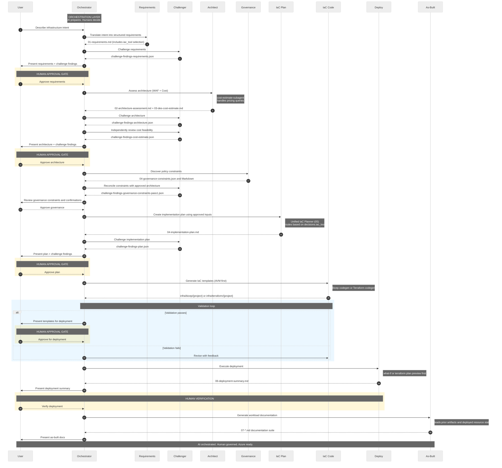

# APEX

Agentic Platform Engineering eXperience for Azure.

APEX turns Azure platform engineering requirements and live subscription evidence into
Well-Architected assessments, evidence-backed cost reports, and deployable Bicep or Terraform
in VS Code with GitHub Copilot.

- [Documentation](https://apexops.pro/) and [documentation source](https://github.com/jonathan-vella/apex-docs)
- [Accelerator template](https://github.com/jonathan-vella/apex-accelerator)
- [MicroHack](https://microhack.apexops.pro/)
- [Contributing guide](https://apexops.pro/project/contributing/)

## Two ways to use APEX

### 1. Infrastructure delivery workflow

`01-Orchestrator` coordinates specialized agents and subagents across Requirements, Architecture
and Cost, Optional Design, Governance, IaC Planning, Bicep or Terraform Code Generation,
Deployment, and As-Built Documentation. Independent `challenger-review-subagent` checks and human
approval gates govern each stage before changes advance.

Early Architecture can start against shared Azure Landing Zones Corp policy assumptions under
`corp-policy-v1`, while IaC planning completion, code generation, and deployment require
target-verified private policy capture. Cost estimates pair workload SKUs with evidence-backed
retail pricing from Azure MCP. Read the [workflow overview](https://apexops.pro/concepts/workflow/).

### 2. Standalone WAF assessment

Run `/waf-assess-existing` in `01-Orchestrator` in `evidence_only` or `requirements_led` mode
against read-only Azure subscriptions, local IaC and diagrams, or both. The assessment generates
a five-pillar Well-Architected report, existing-state SVG and PNG diagrams, Azure Cost
Management analysis with visual charts, and a prioritized Excel and Markdown action register.
Independent quality reviews run before final bundle acceptance. Read the
[WAF assessment guide](https://apexops.pro/guides/waf-assessment/).

## Start here

For new Azure delivery or assessment projects, start from the Accelerator template rather than
cloning this upstream repository:

1. Create a private repository from the
   [Accelerator template](https://github.com/jonathan-vella/apex-accelerator).
2. Clone the new repository to the host machine. Microsoft employees must exit all VS Code
   windows and run `.devcontainer/open-microsoft.ps1` on Windows or
   `bash .devcontainer/open-microsoft.sh` on Linux, macOS, and WSL before starting the
   container. Read [Package Sources](.devcontainer/README.md#package-sources) for host feed
   setup. Everyone else can run `code .`.
3. Reopen the folder in the dev container and follow the
   [quickstart guide](https://apexops.pro/getting-started/quickstart/).

To contribute to APEX, read [AGENTS.md](AGENTS.md) for local setup, repository conventions, and
the `npm run validate:all` validation suite, plus the
[contributing guide](https://apexops.pro/project/contributing/).

## Delivery workflow

## What this repository contains

- Specialized agents, subagents, [skills](.github/skills/README.md), and instruction files for VS Code Copilot
- Reference implementations for Azure Verified Modules in Bicep and Terraform
- `apex-recall` CLI for project session state, step transitions, and review gates
- Validation scripts, MCP configuration, artifact templates, and Architecture Explorer graph metadata

See [CHANGELOG.md](CHANGELOG.md) for release history.

## License

[MIT](LICENSE)
