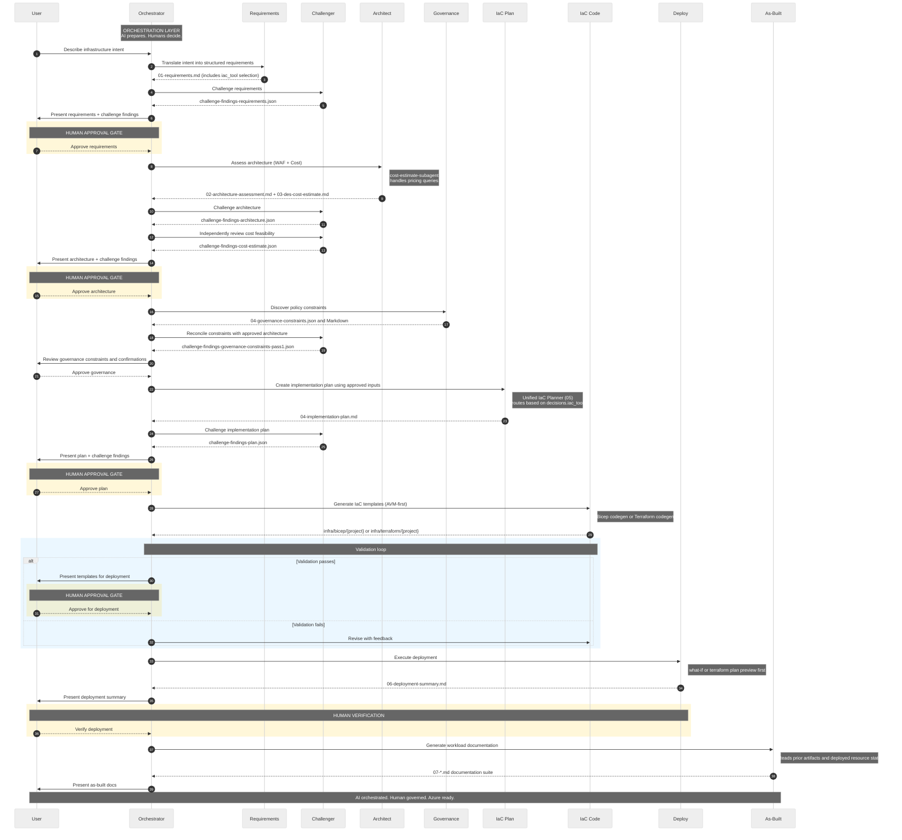

# APEX

Agentic Platform Engineering eXperience for Azure.

APEX is a multi-agent workflow that turns Azure platform engineering requirements into
deployable Bicep or Terraform with human approval gates across the lifecycle.

- [Documentation](https://apexops.pro/) ([source](https://github.com/jonathan-vella/apex-docs))
- [Accelerator template](https://github.com/jonathan-vella/apex-accelerator)
- [MicroHack](https://microhack.apexops.pro/)
- [Contributing guide](https://apexops.pro/project/contributing/)

## Workflow

New projects use the [practical workflow](.github/skills/apex-workflow-engine/references/practical-workflow.md):
reuse captured decisions, batch authorized routine repairs, bound review closure, and check policy feasibility early.
Specialists, production support and the lifecycle approval gates shown below remain.
Existing projects retain their legacy contract until explicitly adopted.
Delivery projects select [policy evidence](.github/skills/apex-azure-governance-discovery/references/policy-source.md)
before Architecture: explicitly accepted standard Corp assumptions or authorized target evidence.
The shared baseline needs no real subscription identifiers; assumptions never authorize implementation.
Native target capture can keep identifying scope and policy snapshots in an owner-only private store.
Private policy collection uses `--retain-rule-evidence` to retain full policy objects and effective parameter/member
lineage inside that same private snapshot. Offline semantic validation requires this evidence; summary-only caches
need a bounded authorized refresh. Existing opaque snapshot hashes bind the raw archive without publishing it in Git.
Retail pricing uses [captured meter evidence](.github/skills/apex-azure-defaults/references/pricing-guidance.md):
monthly estimates require explicit billing inputs and deterministic evidence-linked totals.
Explicit rate-only quotes support unknown monthly usage without approving an incomplete workload estimate.
Recovery preserves raw responses, original timestamps and consumed request allowances.
Older monthly outputs remain historical evidence: use explicit legacy audit for inspection, not current approval.
Refresh into a new owned output with its original request and required review.
Never restamp reviewed prices or reset allowances.

Delivery resume reports actual prerequisite recovery instead of an unconditional ready-to-run handoff.
Stale inputs and exhausted affected reviews return one actionable work package to their owners;
already-current reviews consume no new allowance. Stage scope includes the declared owned reconciliation,
updates and bounded reviews, while new permissions and human stage approvals remain explicit.
See the [complete-stage contract](.github/skills/apex-workflow-engine/references/practical-workflow.md#complete-stage-work-package).
Private-evidence reviewers use canonical literal paths. One verified same-invocation correction of an omitted
scope directory retains the failed read in provenance; missing evidence and access denials still block.

Product documentation uses [source/date references and original billing conclusions](.github/skills/apex-azure-defaults/references/cost-estimate-parent-contract.md#product-documentation-and-publication),
with explicit applicability and limitations, not automatic full-page copies.
Necessary full-text research captures remain private outside Git unless redistribution rights and attribution are
established. Repairing old review-bound captures preserves original evidence privately and historical review records;
changed inputs require revalidation, not restamped approval. Native retail API responses still require exact-byte capture.
Git preserves artifact bytes without line-ending normalization so staged captures retain their evidence hashes.

## Assess an Existing Workload

Use `/waf-assess-existing` with `01-Orchestrator` to assess supplied IaC, diagrams, or explicitly scoped
read-only Azure evidence. Choose evidence-only (no business interview) or requirements-led assessment.
The [standalone workflow](.github/skills/apex-workflow-engine/references/standalone-assessment.md)
delivers a WAF report, architecture diagram and cost report after upfront scope authorization and automatic
internal work, independent WAF/cost-quality reviews and one final bundle acceptance.

Azure cost reports use authorized actual spend, trends and available forecast; IaC-only uses labelled estimates.
The proposed default is last completed calendar month, preceding-month comparison and month-to-date,
with current-month forecast when available. Missing evidence and unpriced costs are explicit gaps, not zeros.
Acceptance is terminal, not remediation, compliance approval or a handoff to formal Governance/deployment.
Existing projects keep their histories and require explicit adoption; the infrastructure delivery workflow is unchanged.
New Azure/combined assessments also deliver an
[Assessment Action Register](.github/skills/apex-azure-artifacts/references/assessment-action-register.md)
as Excel plus Markdown. Actions carry evidence, priorities, qualitative effort, relative recommended windows
and defensible monthly additions/savings/net change. Unknown costs stay unquantified; overlapping benefits
are not summed twice. Edit the structured source and regenerate the snapshot rather than tracking manual Excel changes.
IaC-only export is optional; historical runs keep their captured output contract.
See the [WAF Assessment User Guide](https://apexops.pro/guides/waf-assessment/) for step-by-step walkthroughs
and prompts for both `evidence_only` and `requirements_led` scenarios.

## Start Here

For new projects, start from the Accelerator template rather than cloning this repository
directly:

1. Create a repository from the [Accelerator template](https://github.com/jonathan-vella/apex-accelerator).
2. Open that repository in VS Code and reopen it in the dev container.
3. Follow the [published documentation](https://apexops.pro/).

## What This Repository Contains

- Agent definitions, [skills](.github/skills/README.md), and instruction files for the VS Code Copilot workflow engine
- Reference implementations for Bicep and Terraform tracks
- Validation scripts, MCP configuration, and sample agent outputs
- `apex-recall` CLI for session state and recall across `agent-output/` projects
- Runtime references, artifact templates, and Architecture Explorer graph metadata

See [AGENTS.md](AGENTS.md) for contributor setup, conventions, and validation commands, and
[CHANGELOG.md](CHANGELOG.md) for recent changes.

## License

MIT. See [LICENSE](LICENSE).
