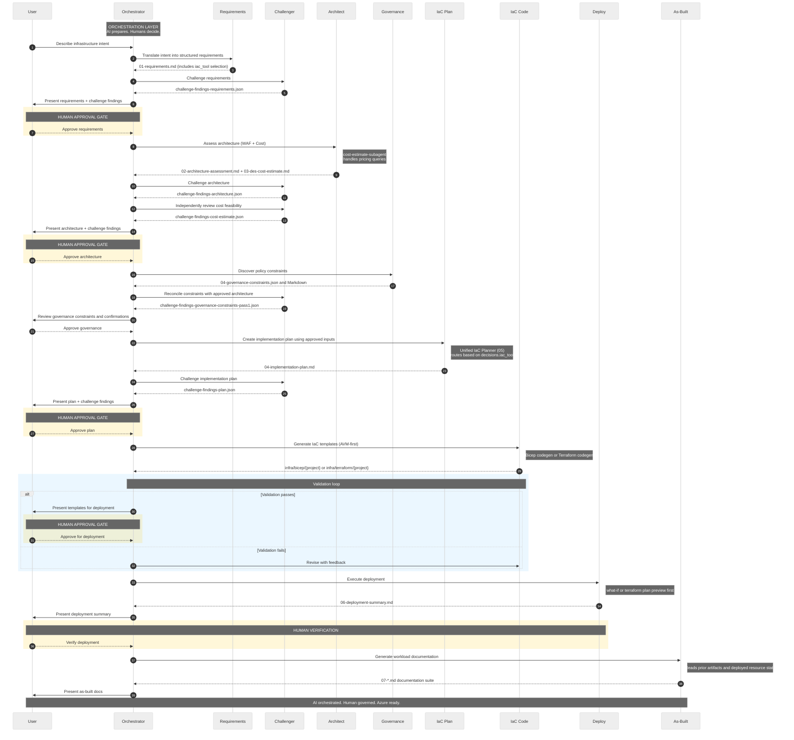

# APEX

Agentic Platform Engineering eXperience for Azure.

This repository is the source project for a multi-agent workflow that turns Azure
platform engineering requirements into deployable Bicep or Terraform with human approval
gates across the lifecycle.

The full documentation for this repository lives here:

- [APEX documentation](https://apexops.pro/)
- [Documentation source and publishing](https://github.com/jonathan-vella/apex-docs)

APEX contains product tooling and runtime guidance. Documentation assets and publishing
are maintained in `apex-docs`; the accelerator distributes consumer workflow templates.

This README is the general documentation entrypoint. `AGENTS.md`, `VERSION.md`, runtime references,
templates and technical CLI contracts remain here because agents and validation depend on them.

Key entry points:

- [Accelerator template](https://github.com/jonathan-vella/apex-accelerator)
- [MicroHack](https://microhack.apexops.pro/)
- [Contributing guide](https://apexops.pro/project/contributing/)

## Workflow

## Start Here

For new projects, use the Accelerator template rather than cloning this repository
directly.

1. Create a repository from the [Accelerator template](https://github.com/jonathan-vella/apex-accelerator).
2. Open that repository in VS Code and reopen it in the dev container.
3. Start with the published docs:
   [https://apexops.pro/](https://apexops.pro/)

## What This Repository Contains

- Agent definitions, skills, and instruction files for the workflow engine
- Reference implementations for Bicep and Terraform tracks
- Validation scripts, MCP configuration, and sample agent outputs
- `apex-recall` CLI for progressive session recall across agent-output projects
- Runtime references, artifact templates, and architecture explorer graph metadata

The [skill catalog](.github/skills/README.md) describes procedure ownership and invocation flags.
For explicit prose cleanup, use [/apex-unslop](.github/skills/apex-unslop/SKILL.md); it is manual-only,
preserves technical content, and is not part of the automatic workflow.
The supported target is the GitHub Copilot SDK harness **inside VS Code**.
Select `01-Orchestrator`, then use
[/apex-workflow-start](.github/skills/apex-workflow-start/SKILL.md) for fresh or `resume` operations.
After human approval, named specialists run through the
[verified worker protocol](.github/skills/apex-workflow-engine/references/worker-readiness.md).
Active agents omit model and reasoning-effort pins; the operator and runtime
control selection, including Auto and HydraFusion. Readiness is model-agnostic:
model names, effort, picker selection and model-source labels are diagnostics only.
Skills inherit caller model/tools; completion never bypasses approval or independent review.
Legacy Local prompts are retired and excluded from active discovery.
Worker identity, dispatch linkage, tool-free same-worker continuation, required
tools and human approval still require runtime verification.
Automatic independent reviews use the shared read-only `challenger-review-subagent` through the
[one-shot review contract](.github/skills/apex-azure-defaults/references/one-shot-review.md),
without reviewer handshake/ACK turns. The owning step records the actual attributed
result via `record-review.mjs`, validates strict cache freshness and returns to the same Orchestrator;
historical `rubber-duck` receipts remain read-only compatibility. `10-Challenger`
remains optional manual review/repair. Technical handoffs do not approve human gates.

APEX's former tool-guardian and subagent-validation runtime hooks are retired.
There are no active `.github/hooks/` registrations or replacement runtime guards.
This removes their tool-interception and automatic post-subagent validation behavior;
native Copilot permissions and human approvals are not equivalent security enforcement.
Lefthook Git pre-commit/pre-push checks and CI validation remain separate and unchanged.
Run `npm run test:git-hooks` for Lefthook configuration tests; `npm run validate:vscode`
also rejects enabled retired hook settings. The former `test:hooks` and `validate:hooks` commands are removed.

Explicit risk acceptance is supported only for authorized non-production labs, with externally verified authority,
individual finding selection and separate human gate approval. Kit authoring permission never grants deployment
permission; original review verdicts and unresolved findings remain intact. Maintainer and CLI contract:
[risk-authorizations.md](tools/apex-recall/docs/risk-authorizations.md).

## License

MIT. See [LICENSE](LICENSE).
